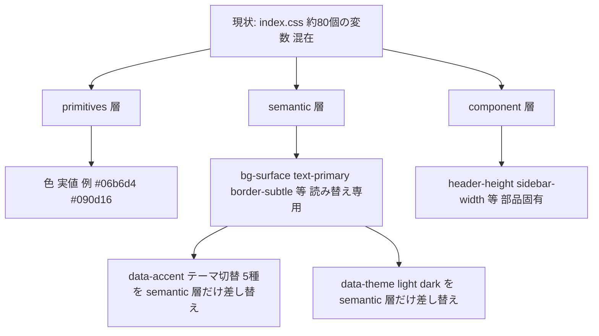
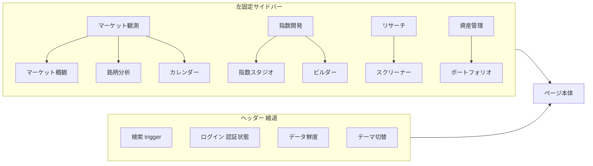
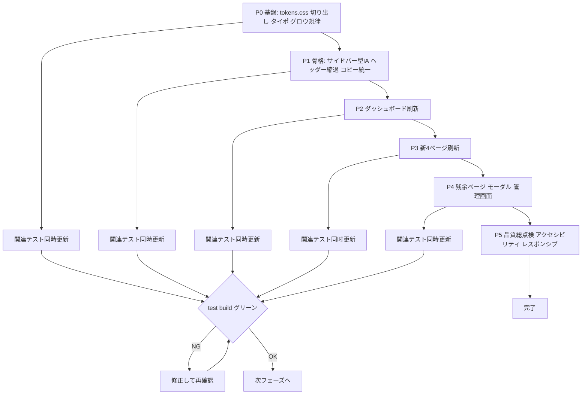

# 統合投資情報プラットフォーム UI全面刷新 実装計画

## 1. 背景と目標

直近の実装で [`marketDataService.ts`](../src/lib/marketDataService.ts) を軸に、マーケット概観・銘柄分析・スクリーナー・カレンダーの4ページが追加され、 [`PageView`](../src/lib/navigation.ts:1) は10ビューに拡大した。一方で UI は旧「独自株価指数トラッカー」時代のまま、情報設計・ブランドコピー・視覚言語が分裂している。

**目標**: ダークQuant風の視覚言語を継続・精続・精錬しつつ、トークン・タイポグラフィ・ナビゲーション構造・全ページを一体で刷新し、「統合投資情報プラットフォーム」としての一貫性を獲得する。

### 確定した方針

| 論点 | 決定 |
|---|---|
| スコープ | 全面刷新(トークン・タイポ・IA・全ページ) |
| ビジュアル方向 | ダークQuant風を継続・精錬。シアン基調維持、トークン整理・タイポ再設計・グロウ乱用排除 |
| CSS資産 | 段階分割。第1段階はトークンのみ `tokens.css` へ切り出し、残りはページ刷新に合わせて随時分割 |
| テスト | 各ページ刷新と同時にソースアサーションテストを更新し、常にグリーンを維持 |
| ナビゲーション | グローバルサイドバー型に統一。ヘッダーは検索・認証・データ鮮度のみに縮退 |

## 2. デザイントークン計画

### 2.1 トークン整理

現状 [`index.css`](../src/index.css:1) の先頭には表面・ニュオン・グロウが約80個の変数として渾然と並ぶ。役割別に4層へ再編し、 `src/styles/tokens.css` へ切り出す。

- **primitives**: 色実値のみ。 `--c-cyan-500: #06b6d4` 等、絶対値
- **semantic**: 背景・文字・罫線・状態の役割名。テーマ/アクセント切替はこの層の差し替えだけで完結
- **component**: `--header-height` / `--sidebar-width` などレイアウト固有値
- **削減対象**: `--neon-*` 系は accent トークンへ集約(重複排除)、 `--glow-*` は状態表現専用へ制限(§3参照)

### 2.2 タイポグラフィ再設計

現状: [`--display-font`](../src/index.css:5) に `"Inter", "Outfit"` の順で重複宣言、 `--mono-font` は `"JetBrains Mono", "Share Tech Mono"` の二重管理。

| 役割 | 書体 | 用途 |
|---|---|---|
| Display | **Outfit** | ページ見出し・大型数値(stat値・騰落率) |
| Body | **Inter** | 本文・UIラベル・テーブル |
| Data | **JetBrains Mono** | 値・ティッカー・日付・コード表示。 `Share Tech Mono` は廃止 |

- スケールをトークン化: `--fs-xs: 11px` 〜 `--fs-3xl` まで段階を固定し、既存の個別 `font-size: 12` インライン宣言を順次置換
- 数値は等幅 + `font-variant-numeric: tabular-nums` を全テーブル・統計値に適用し、桁揃えを保証
- 見出しの letter-spacing 調整(日本語見出しは -0.02em、英字ラベルは 0 に統一)

## 3. グロウ・エフェクトの規律

「AI生成っぽいネオンヘイズ」の排除を目的に、グロウの使用を規則で固定する。

- `--glow-*` が使えるのは **状態の変化**(データ更新時のみのフラッシュ、エラー、初回表示)だけ。装飾目的の常時発光は全廃
- カードの `box-shadow` は2値(沈み影 + ベース影)に統一し、 `rgba(0,0,0,.1)` 単発のSaaSデフォルト影を排除
- アクセントの `--accent-glow` は「フォーカスリング・アクティブタブ・プライマリボタン」の3用途のみ
- ホバー演出は `transition: 150ms ease` を基準値に統一。 `hover` で全カードが浮く様式を廃し、操作可能な要素だけに反応を限定

## 4. ナビゲーション構造の刷新(IA再設計)

### 4.1 構造案

| グループ | ビュー |
|---|---|
| マーケット観測 | `market` / `stock` / `calendar` |
| 指数開発 | `dashboard` / `builder` |
| リサーチ | `screener` |
| 資産管理 | `portfolio` |
| サブ(折りたたみ) | `tutorial` / `disclaimer` / `admin` |

### 4.2 実装方針

- **新規**: [`Sidebar.tsx`](../src/components/Sidebar.tsx) を作成し、 [`PageLayout`](../src/App.tsx:83) に組み込む
- **縮退**: [`Header.tsx`](../src/components/Header.tsx:237) の `header-primary-nav` 6タブ・「その他」ドロップダウン・モバイルドロワーのナビ部分を廃止。残るのはブランド・検索・認証・ [`DataFreshness`](../src/components/DataFreshness.tsx:23)・ [`ThemeControls`](../src/components/ThemeControls.tsx:6)
- **状態統合**: [`App.tsx`](../src/App.tsx:126) の `isSidebarOpen` / `isDesktopSidebarOpen` は新サイドバーに統合し、既存の重複状態を解消
- **モバイル**: サイドバーはドロワー化(現行ヘッダードロワーのトグルロジック・フォーカストラップを移植)。 `≤1080px` の [`MOBILE_LAYOUT_QUERY`](../src/App.tsx:80) を踏襲
- **コピーブランド統一**: ヘッダー [`header-desc`](../src/components/Header.tsx:231)・ [`Footer`](../src/components/Footer.tsx:81)・ [`PortfolioPage`](../src/components/PortfolioPage.tsx:129) の「独自株価指数トラッカー」系コピーを「統合投資情報プラットフォーム」系へ統一。README の特徴記述も更新

## 5. ページ刷新の順序と範囲

| フェーズ | 対象 | 主なファイル | 要点 |
|---|---|---|---|
| P0 基盤 | トークン・タイポ | `src/styles/tokens.css`(新)・ [`index.css`](../src/index.css:1) | トークン4層化・書体整理・グロウ規律。全ページ共通の土台 |
| P1 骨格 | ナビ・レイアウト | `Sidebar.tsx`(新)・ [`Header.tsx`](../src/components/Header.tsx)・ [`App.tsx`](../src/App.tsx)・ [`Footer.tsx`](../src/components/Footer.tsx) | サイドバー型IA・ヘッダー縮退・ブランドコピー統一 |
| P2 主役 | ダッシュボード(指数スタジオ) | [`StatsGrid`](../src/components/StatsGrid.tsx)・ [`PerformanceChart`](../src/components/PerformanceChart.tsx)・ [`ThemeHeatmap`](../src/components/ThemeHeatmap.tsx)・ [`RiskMetricsCard`](../src/components/RiskMetricsCard.tsx)・ [`ConstituentsTable`](../src/components/ConstituentsTable.tsx) | 大型数値を Outfit に、テーブル密度・tabular-nums 整備 |
| P3 新機能群 | 新4ページ | [`MarketOverviewPage`](../src/components/MarketOverviewPage.tsx)・ [`StockDetailPage`](../src/components/StockDetailPage.tsx)・ [`ScreenerPage`](../src/components/ScreenerPage.tsx)・ [`CalendarPage`](../src/components/CalendarPage.tsx) | 旧ダッシュボードとの質感差を解消。インラインstyleのクラス化も同時進行 |
| P4 残余 | その他全ページ | [`PortfolioManagerPage`](../src/components/PortfolioManagerPage.tsx)・ [`IndexBuilderPage`](../src/components/IndexBuilderPage.tsx)・ [`AdminDashboard`](../src/components/AdminDashboard.tsx)・ [`TutorialPage`](../src/components/TutorialPage.tsx)・モーダル群・ [`DisclaimerPage`](../src/components/DisclaimerPage.tsx) | 同一トークン・同一密度へ統一 |
| P5 検証 | 品質総点検 | 全テスト・アクセシビリティ | グリーン維持の最終確認・WCAGコントラスト・reduced-motion・レスポンシブ全幅確認 |

各フェーズの完了条件: 該当ページの視覚刷新 + 関連CSSクラス整理 + **該当するソースアサーションテストの同時更新** + `npm run test` / `npm run build` グリーン。

## 6. テスト同時更新の対象

CSS文字列・クラス名に依存するテストはフェーズごとに該当分を更新する。主な対象:

- P0/P1: [`regression.test.ts`](../src/lib/regression.test.ts) (`--surface-hover` 等のトークン存在検査)・ [`customIndexHeaderEnhancements.test.ts`](../src/lib/customIndexHeaderEnhancements.test.ts) (`.top-header` z-index)・ [`uiEnhancementsReview.test.ts`](../src/lib/uiEnhancementsReview.test.ts) (ヘッダー2行・モバイルドロワー)・ [`headerAccessibility.test.ts`](../src/components/headerAccessibility.test.ts)
- P2: [`reviewRegression.test.ts`](../src/lib/reviewRegression.test.ts) (ボタン/統計タイポ)・ [`mobileOptimizationReview.test.ts`](../src/lib/mobileOptimizationReview.test.ts) (chart/stat レスポンシブ)
- P3: [`chartModalResponsive.test.ts`](../src/lib/chartModalResponsive.test.ts)・ [`tradingViewWidgetEnhancements.test.ts`](../src/lib/tradingViewWidgetEnhancements.test.ts)・ [`mobileAndVisualEnhancements.test.ts`](../src/lib/mobileAndVisualEnhancements.test.ts)
- P4: [`portfolioResponsive.test.ts`](../src/lib/portfolioResponsive.test.ts)・ [`userRequestedEnhancements.test.ts`](../src/lib/userRequestedEnhancements.test.ts)・ [`comprehensiveUiReviewFixes.test.ts`](../src/components/comprehensiveUiReviewFixes.test.ts)・ [`tutorialPageEnhancements.test.ts`](../src/lib/tutorialPageEnhancements.test.ts)
- トークンファイル分割時は `readFileSync(resolve(__dirname, "../index.css"))` のパス参照を `src/styles/tokens.css` へ読み替え

## 7. リスクと対策

| リスク | 対策 |
|---|---|
| 6,050行CSSの変更が全ページに波及 | トークン先行・値の実質変更をP0に集約。以降のフェーズはクラス局部所改修に限定 |
| 大量のソースアサーションテストが赤化 | フェーズ単位でテストを同時更新し、フェーズ境界で必ずグリーン確認 |
| サイドバー移行で [`navigation.ts`](../src/lib/navigation.ts) のルーティング破壊 | URL・ [`PageView`](../src/lib/navigation.ts:1) は変更しない。移るのは表示構造のみ |
| ライトテーマ・5アクセントの二重差し替え漏れ | semantic層のみで完結するよう tokens.css を設計し、テーマ別テストで検証 |
| inline style の多用( [`Header.tsx`](../src/components/Header.tsx:192) 等) | 対象ページ刷新時にクラスへ移行 |

## 8. Mermaid: 全体フロー

